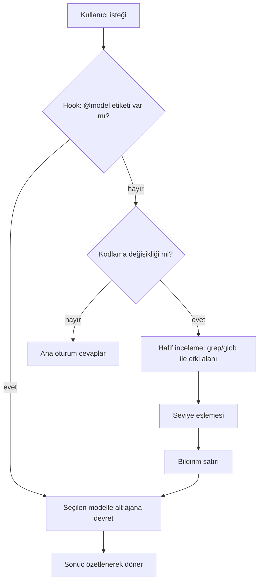

<div align="center">

# 🧭 Model Router

**Claude Code için otomatik model yönlendirme.**
İsteğin boyutuna ve etki alanına bakar, işi doğru modele devreder.

`Haiku` · `Sonnet` · `Opus` · `Fable`

</div>

---

Küçük bir yazım hatası için en güçlü modeli, karmaşık bir refactor için en hafif modeli kullanmak zorunda değilsin. **Model Router**, kodlama isteğini inceler, kapsamına uygun modelde bir alt ajan başlatır ve ne seçtiğini sana söyler:

```
→ Opus'a yönlendirildi: 12 dosyayı etkileyen refactor
```

Ana konuşmanın modeli değişmez. İş, seçilen modelle çalışan bir alt ajanda yapılır ve sonucu sana özetlenerek döner.

## ✨ Özellikler

- **Otomatik seçim:** İstek metni ve hafif bir kod incelemesiyle (etkilenen dosya ve modül sayısı) model seçilir.
- **Şeffaflık:** Her yönlendirmede hangi modelin neden seçildiği tek satırla bildirilir.
- **Tam kontrol:** İsteğe `@haiku`, `@sonnet`, `@opus` veya `@fable` ekleyerek seçimi sen yaparsın. Senin seçimin her zaman kazanır.
- **Sessiz kalır:** Soru, açıklama ve sohbet isteklerinde devreye girmez.
- **İsteği engellemez:** Hook hata verse bile isteğin normal şekilde devam eder.

## 🚀 Kurulum

Claude Code içinde:

```
/plugin marketplace add Fatal-IV/model-router
/plugin install model-router@ik-software-plugins
```

Kabuktan:

```bash
claude plugin marketplace add Fatal-IV/model-router
claude plugin install model-router@ik-software-plugins
```

> **Gereksinim:** PATH üzerinde [Node.js](https://nodejs.org). Hook bir Node betiğidir; Node yoksa her istekte "hook error" bildirimi görürsün. Claude Code'u npm ile kurduysan Node zaten vardır.

Kurulumdan sonra `/reload-plugins` çalıştır. Başka bir ayar gerekmez.

## 🎯 Hangi iş hangi modele gider?

| Model | Ne zaman | Örnek |
|---|---|---|
| **Haiku** | Tek dosya, mekanik değişiklik | Yazım hatası, renk veya isim değişikliği, yorum ekleme |
| **Sonnet** | Birkaç dosyayı etkileyen normal iş | Avatar yükleme ekleme, form doğrulama hatası düzeltme |
| **Opus** | Çok dosyalı, modüller arası değişiklik | Auth katmanını refactor etme, zor bir hatayı ayıklama |
| **Fable** | Mimari kararlar, çok yüksek riskli veya belirsiz işler | Monolitten servis mimarisine geçiş |

İki seviye arasında kalırsa **bir üst seviye** seçilir.

## 🕹️ Modeli kendin seç

```text
@haiku bu butonun rengini yeşil yap
@opus'la auth katmanını refactor et
@fable projeyi servis mimarisine böl
```

Etiket cümlenin herhangi bir yerinde olabilir (büyük/küçük harf fark etmez, `@opus'la` gibi ekli yazım da çalışır). `@haiku bu fonksiyon ne yapıyor?` gibi bir soruda bile seçtiğin model kullanılır.

## ⚙️ Nasıl çalışır?



| Parça | Görevi |
|---|---|
| `hooks/route-hook.js` | Her istekte çalışır, `@model` etiketini yakalar ve Claude'a yönlendirme skill'ini hatırlatır. İsteği asla engellemez. |
| `skills/model-routing` | Etki alanını ölçer, seviyeyi seçer, bildirir ve `Agent` aracını `model` parametresiyle çağırır. |

## ⚠️ Bilinen sınırlamalar

- Hook yalnızca skill'in tetiklenmesini sağlar. **Seviye kararı modelin yargısıdır** ve her zaman doğru olmayabilir. Yanlış seçimi `@model` ile düzeltebilirsin.
- `CLAUDE_CODE_SUBAGENT_MODEL_FORCE=1` ayarlıysa çağrı başına model seçilemez; yönlendirme bu durumda devre dışı kalır ve sana bildirilir.
- Ana oturumun kendisi hiçbir zaman model değiştirmez; yönlendirme alt ajan üzerinden yapılır.

## 🛠️ Geliştirme

```bash
# Hook testleri
node --test model-router/hooks/route-hook.test.js

# Plugin ve marketplace doğrulaması
claude plugin validate ./model-router
claude plugin validate .

# Yayınlamadan yerelde dene
claude --plugin-dir ./model-router
```

Elle doğrulama senaryoları: [`model-router/tests/scenarios.md`](model-router/tests/scenarios.md). Tasarım ve plan belgeleri: [`docs/superpowers`](docs/superpowers).

## 📄 Lisans

MIT
