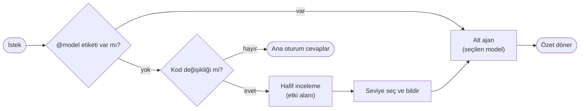

<div align="center">

<h1>Model Router</h1>

<p><strong>Her iş için doğru model.</strong><br/>
Claude Code isteğini okur, kapsamına bakar ve işi Haiku, Sonnet, Opus veya Fable'a otomatik devreder.</p>

<p>
  
  
  
</p>

<pre>→ Opus'a yönlendirildi: 12 dosyayı etkileyen refactor</pre>

</div>

<br/>

## Neden?

Yazım hatası düzeltmek için en güçlü modeli, mimari bir değişiklik için en hafif modeli kullanmak zorunda değilsin. Model Router her kodlama isteğini ölçer, kapsamına uygun modelde bir alt ajan başlatır ve **ne seçtiğini sana söyler**. Ana konuşmanın modeli değişmez; sonuç özetlenerek sana döner.

<table>
<tr>
<td width="25%"><b>Otomatik</b><br/>İstek metni ve hafif kod incelemesiyle seçim yapar.</td>
<td width="25%"><b>Şeffaf</b><br/>Her yönlendirmede model ve gerekçe tek satırla bildirilir.</td>
<td width="25%"><b>Kontrol sende</b><br/><code>@opus</code> gibi bir etiketle seçimi sen yaparsın.</td>
<td width="25%"><b>Rahatsız etmez</b><br/>Soru ve sohbetlerde devreye girmez, isteği engellemez.</td>
</tr>
</table>

<br/>

## Kurulum

```bash
claude plugin marketplace add Fatal-IV/model-router
claude plugin install model-router@ik-software-plugins
```

Claude Code içinden de olur: `/plugin marketplace add Fatal-IV/model-router`, ardından `/plugin install model-router@ik-software-plugins`. Kurulumdan sonra `/reload-plugins` yeterli.

> [!IMPORTANT]
> PATH üzerinde [Node.js](https://nodejs.org) olmalı. Hook bir Node betiğidir; Node yoksa her istekte "hook error" bildirimi görürsün. Claude Code'u npm ile kurduysan Node zaten vardır.

<br/>

## Hangi iş hangi modele gider?

| | Model | Ne zaman | Örnek |
|:-:|---|---|---|
| ⚡ | **Haiku** | Tek dosya, mekanik değişiklik | Yazım hatası, renk veya isim değişikliği |
| ⚖️ | **Sonnet** | Birkaç dosyayı etkileyen normal iş | Avatar yükleme ekleme, doğrulama hatası düzeltme |
| 🧠 | **Opus** | Çok dosyalı, modüller arası değişiklik | Auth refactor'ü, zor hata ayıklama |
| 🏛️ | **Fable** | Mimari, çok yüksek riskli veya belirsiz işler | Monolitten servis mimarisine geçiş |

İki seviye arasında kalırsa bir üst seviye seçilir.

<br/>

## Modeli kendin seç

İsteğin herhangi bir yerine bir etiket ekle. Senin seçimin her zaman otomatik seçimin önüne geçer.

```text
@haiku butonun rengini yeşil yap
@opus'la auth katmanını refactor et
@fable projeyi servis mimarisine böl
```

Büyük/küçük harf fark etmez, `@opus'la` gibi ekli yazım da çalışır. Soru bile olsa seçtiğin model kullanılır: `@haiku bu fonksiyon ne yapıyor?`

<br/>

## Nasıl çalışır?



- **`hooks/route-hook.js`** her istekte çalışır, `@model` etiketini yakalar ve Claude'a yönlendirme skill'ini hatırlatır. İsteği asla engellemez.
- **`skills/model-routing`** etki alanını ölçer, seviyeyi seçer, bildirir ve `Agent` aracını `model` parametresiyle çağırır.

<br/>

## Sınırlamalar

> [!NOTE]
> Hook yalnızca skill'in tetiklenmesini sağlar. **Seviye kararı modelin yargısıdır** ve her zaman doğru olmayabilir. Yanlış seçimi `@model` ile düzeltebilirsin.

- `CLAUDE_CODE_SUBAGENT_MODEL_FORCE=1` ayarlıysa çağrı başına model seçilemez. Yönlendirme bu durumda devre dışı kalır ve sana bildirilir.
- Yönlendirme alt ajan üzerinden yapılır; ana oturumun kendi modeli değişmez.

<br/>

<div align="center">
<br/>
<sub>© 2026 IK Software · Tüm hakları saklıdır</sub>
</div>
